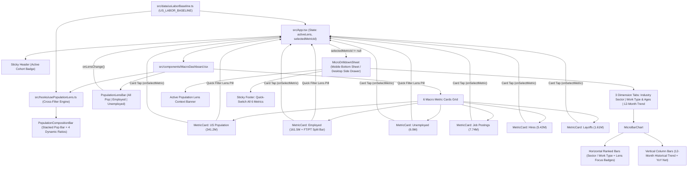

# Roadmap

Phases are intentionally small — each should be implementable in one focused session.

---

## Phase 1: Project Scaffold, US Labor Data Engine & Macro Dashboard

**Goal:** Stand up the mobile-first React + TypeScript + Tailwind application with the verified US BLS/JOLTS dataset and render the 6 core Macro Metric Cards (US Population, Employed with Full-Time/Part-Time split, Unemployed, Job Postings, Hires, and Layoffs) that scale cleanly from mobile to desktop.

- [x] Initialize Vite + React 19 + TypeScript + Tailwind CSS + Vitest project structure in `us-job-pulse`.
- [x] Define core TypeScript domain models (`src/types/labor.ts`) for the 6 macro metrics, Full-Time vs. Part-Time employment sub-splits, population lenses, and micro bar-chart series.
- [x] Create the verified US Labor baseline data store (`src/data/usLaborBaseline.ts`) with realistic BLS CPS & JOLTS figures, per-second flow rates, industry sectors, demographics, and 12-month history.
- [x] Build the responsive mobile-first `MacroDashboard` and `MetricCard` components featuring visual Full-Time vs. Part-Time breakdown inside the Employed card and clear MoM badges.
- [x] Write automated unit and component tests (`tests/phase1-macro-dashboard.test.tsx`) verifying all 6 macro metrics and the Full-Time/Part-Time breakdown render accurately.

---

## Phase 2: Realtime Employed / Unemployed Population Lens Cross-Filtering

**Goal:** Enable one-tap switching between **All Population**, **Employed (Full-Time / Part-Time)**, and **Unemployed** directly on the front dashboard so all macro cards, population percentages, and labor ratios dynamically recalculate and highlight in real time.

- [x] Implement the `PopulationLensBar` segmented toggle control (`All US Population`, `Employed`, `Unemployed`) pinned cleanly at the top of the front dashboard, plus direct quick-filter triggers on the Employed and Unemployed cards.
- [x] Build the `usePopulationLens` cross-filter computation engine that recalculates contextual metrics in real time (e.g., Employed mode highlights Full-Time vs. Part-Time share, Active Hires rate, and Job Openings rate; Unemployed mode highlights U-3 vs. U-6 unemployment, Job Postings per Unemployed Person ratio, and Layoffs share).
- [x] Add interactive Population Composition Bar & contextual KPI callout pills that morph smoothly when switching between `All`, `Employed`, and `Unemployed`.
- [x] Write automated tests (`tests/phase2-population-lens.test.tsx`) verifying that clicking Employed or Unemployed dynamically updates displayed population metrics and contextual indicators in real time.

---

## Phase 3: Macro-to-Micro Interactive Bar Chart Drill-Downs

**Goal:** Allow clicking into any of the 6 Macro Metric Cards to open the Micro View displaying interactive bar charts across Industry Sectors, Demographics/Work Status, and 12-Month Historical Trends.

- [x] Build the `MicroBarChart` component supporting horizontal ranked bars (for Industry Sectors & Demographics) and vertical time-series bars (for 12-Month Trends), with animated fill bars, value labels, percentage shares, and MoM delta indicators.
- [x] Build the responsive `MicroDrilldownSheet` (touch-friendly bottom sheet on mobile viewports, sleek side/modal panel on desktop viewports) triggered by clicking any of the 6 Macro Metric Cards.
- [x] Wire dimension tabs (`By Industry Sector`, `Demographics & Work Type`, `12-Month Trend`) and connect the active `Employed` / `Unemployed` lens so micro bar charts also reflect the user's selected cohort context.
- [x] Write automated tests (`tests/phase3-micro-barcharts.test.tsx`) verifying that clicking each macro metric opens its micro bar chart view and switches cleanly across all 3 breakdown dimensions.

---

## Phase 4: Realtime Velocity Ticker, Desktop Layout Polish & End-to-End Verification

**Goal:** Add the hybrid Realtime Velocity Ticker (live per-second hires, job postings, and layoffs flow simulation based on US run-rates), desktop multi-column side-by-side comparison mode, and full verification.

- [ ] Implement the `useRealtimePulse` hook and `LiveVelocityBanner` allowing users to toggle between **Official BLS Snapshot**, **Live Session Ticker** (real-time hires, layoffs, and postings since opening the app), and **Today's US Labor Flow** (estimated cumulative US labor events today).
- [ ] Enhance desktop responsiveness (`lg:` / `xl:` breakpoints) so desktop users can view the 6-card Macro Grid alongside a persistent or split-screen Micro Bar Chart inspector while keeping mobile compact and thumb-friendly.
- [ ] Persist user preferences (`PopulationLens`, `LivePulseMode`) in `localStorage` and add a quick "Reset / Compare" utility.
- [ ] Run full test suite (`npm test`), typecheck (`npm run typecheck`), and production build (`npm run build`) to verify zero errors.

---

## Architecture & Flow Diagram Tree



---

## Component & File Tree

```text
us-job-pulse/
├── specs/
│   ├── mission.md                        # Product vision, entities, scope boundaries
│   ├── tech-stack.md                     # React 19, TS, Tailwind, Vitest conventions
│   └── roadmap.md                        # Phased checklist, architecture flow & file tree
├── src/
│   ├── types/labor.ts                    # Domain interfaces & union types
│   ├── data/usLaborBaseline.ts           # BLS/JOLTS baseline, breakdowns, run-rates
│   ├── hooks/usePopulationLens.ts        # Realtime Employed/Unemployed ratio & highlight logic
│   ├── components/
│   │   ├── MacroDashboard.tsx            # Orchestrates lens bar, composition bar, grid & sheet
│   │   ├── PopulationLensBar.tsx         # Front 3-way cohort toggle (All / Employed / Unemployed)
│   │   ├── PopulationCompositionBar.tsx  # Stacked population bar & 4 dynamic ratio cards
│   │   ├── MetricCard.tsx                # 6 macro cards + FT/PT split bar + quick-filter pill
│   │   ├── MicroDrilldownSheet.tsx       # Responsive mobile bottom sheet / desktop drawer
│   │   └── MicroBarChart.tsx             # Horizontal ranked & vertical 12M bar charts
│   ├── test/setup.ts                     # Vitest + Testing Library setup
│   ├── App.tsx                           # Root state (activeLens, selectedMetricId)
│   ├── main.tsx                          # React 19 mount entry point
│   └── index.css                         # Tailwind base & custom dark scrollbar styling
└── tests/
    ├── phase1-macro-dashboard.test.tsx   # Phase 1 verification (4 tests)
    ├── phase2-population-lens.test.tsx   # Phase 2 verification (5 tests)
    └── phase3-micro-barcharts.test.tsx   # Phase 3 verification (3 tests)
```
